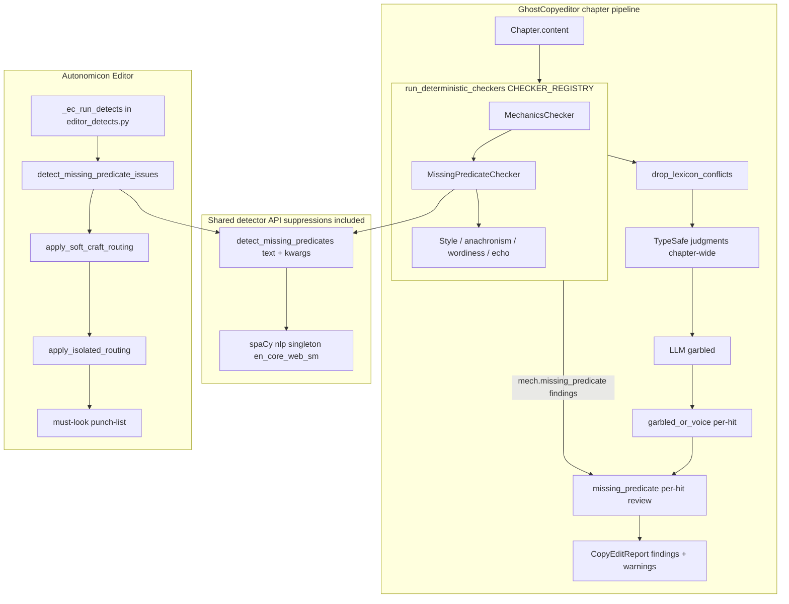

# Missing-predicate detection (no finite predicate — ROOT or aux)

| Field | Value |
|-------|-------|
| **Author** | _(agent)_ |
| **Date** | 2026-10-17 |
| **Status** | Draft (rev 4 — title/naming alignment) |
| **Primary repo** | `C:\Users\shinr\Projects\GhostCopyeditor` (Shinran7/GhostCopyeditor #1) |
| **Secondary** | `C:\Users\shinr\Projects\Autonomicon` Editor soft / must-look routing |
| **Related design** | `docs/GhostCopyeditor-v1-System-Design.md` |
| **Audience** | Implementers landing ordered YOLO slices on `master` |

---

## Overview

GhostCopyeditor misses a common copyedit defect: a **period-terminated sentence whose main clause has no finite verb** (no predicate). The Resonance Ch4 opening is the fixture:

> A rough chatter through Kieran's palm as he lifted the hauler clear of the buttress.

The subordinate *as he lifted…* has a verb, so "sentence contains a verb" is wrong. The line ends with `.`, so today's `_looks_like_fragment` in `ghostcopyeditor/typesafe/state.py` (no terminal `.?!`) never samples it. LLM garbled on the same chapter caught other wreckage and still missed this opener. Autonomicon Editor soft-listed the span as `noun_stack` / `instrument_garnish` — wrong class, no repair.

This design adds a **spaCy dependency check**: for each period-terminated prose sentence, if the clause has **no finite predicate** (ROOT is not a finite verb **and** no finite `aux`/`auxpass`/`cop` child), raise a hand. GhostCopyeditor owns the detector and reports hygiene. A **per-finding** TypeSafe review (same shape as `garbled_review.py`) confirms broken vs intentional fragment or voice. Autonomicon Editor calls the **same** shared detect API (suppressions included) and routes hits to **must-look / isolated**, never silent massage. v1 is report-only.

---

## Background & Motivation

### Current state (GhostCopyeditor)

Pipeline order is fixed (`ghostcopyeditor/pipeline/runner.py`):

1. Deterministic checkers via `run_deterministic_checkers` (`CHECKER_REGISTRY`: mechanics → style → anachronism → wordiness → echo). Lexicon conflict drop runs immediately after.
2. TypeSafe judgments (`typesafe/judgments.py` + `state.sample_candidate_passages`) — chapter-wide ask; adapters **emit new** findings only.
3. LLM garbled (`llm_engine/garbled.py` + `prompts.py`)
4. TypeSafe **per-finding** garbled-or-voice review (`typesafe/garbled_review.py`) — mutates/drops prior `llm.garbled` findings
5. `drop_brute_echo`, cast apply, pronoun findings, lexicon drop again, IDs, dedupe

Relevant gaps:

| Surface | What it does today | Why the specimen slips |
|---------|--------------------|------------------------|
| `_looks_like_fragment` (`typesafe/state.py`) | Paragraph > 40 chars with **no** trailing `.?!` | Specimen **has** a period |
| `MechanicsChecker` | Double space, trailing ws, space-before-punct, repeated `!`/`?` | No predicate / clause structure |
| LLM garbled prompt | Dropped words, truncated sentences, smash | Whole-chapter ask; this opener still escaped (2026-10-17 companion) |
| Autonomicon `#327` dropped-verb mash | Regex `she her field` gaps only | Different failure class; explicitly **non-goal** spaCy |

`CopyEditReport.warnings` is assembled in `commands/companion.py` / `analyze.py` from discovery, lexicon/cast notices, and apply — **not** from `Checker.check()` (returns `list[Finding]` only).

### Operator decisions already locked

1. Missing predicate is **core copyedit**; GCE owns it (issue #1).
2. Signal is spaCy-class dependency: **no finite predicate** (`has_finite_predicate` false — ROOT not finite **and** no finite `aux`/`auxpass`/`cop` child) — not bag-of-verbs, not "no period".
3. Tree raises the hand; LLM / TypeSafe confirm broken vs intentional fragment / voice.
4. Fast enough for chapter scale; dual-pipeline OK: **shared detector**, GCE reports hygiene, Editor flags must-look / soft GhostCopyeditor-class leftover — **no silent rewrite in v1**.
5. Capability stays even if Luna drafts are replaced.
6. Delivery: YOLO on `master` (no `gh pr create`); design still lists ordered implement slices.

### Pain

- Reader stumble that looks "finished."
- Wrong Editor class (`noun_stack`) hides the real defect in soft craft.
- Punctuation-only fragment sampling cannot see it.
- Prompt-only LLM is not reliable for this class (already proven once).

---

## Goals & Non-Goals

### Goals

1. Deterministic **sentence-level** candidate: period-terminated sentence with **no finite predicate** (ROOT not finite and no finite aux/auxpass/cop child) → finding (and TypeSafe per-hit confirm input).
2. Integrate spaCy as an **optional** dep: load-once, Windows-friendly, soft-skip if model missing with a **mandatory** report warning + one-time stderr.
3. Confirm path: **per-finding** TypeSafe review (garbled_review pattern); LLM garbled prompt reinforcement secondary; **report-only** in v1 (`applyable=False`).
4. Fixture: Resonance-style opening **must** emit `mech.missing_predicate` (anchored excerpt). Record ROOT on `en_core_web_sm` in Slice 1 tests (`chatter` / `NOUN` / `NN`). Hard gate for **default-on** is before **Slice 2** merge (checker enabled), after passive/perfect quiet fixtures pass.
5. Keep punctuation-only `_looks_like_fragment` for mid-edit / no-punct sampling; **add** missing-predicate spans to `sample_candidate_passages` with **priority fill** (see below).
6. Export a small **shared detector API** (suppressions inside the API) so Autonomicon Editor does not fork logic or drift quiet rules.
7. Autonomicon Editor slice: pin emit seat; map hits to **must-look / isolated**; no massage apply; no `#327` interaction.
8. Stay inside chapter-grain companion/analyze (no scene model).

### Non-Goals

- Silent or `--apply` rewrite of missing predicates in v1.
- Scene-level analysis; Zipf thrash; Ghostreader craft/continuity.
- Replacing Autonomicon `#327` pronoun+possessive dropped-verb regex with spaCy.
- Full grammar suite / LanguageTool / Vale as the v1 engine.
- New `ghostcommon` monorepo package (still premature; see Alternatives).
- Inventing the missing verb automatically.
- Hard-fail CLI exit when the model is missing (always exit 0 on successful run).
- Candidate-only-until-confirmed quiet mode (rejected — deterministic WARNING always lands; see Key Decision 5).

---

## Proposed Design

### High-level flow



Lexicon/cast filtering still follows `runner.py` (drop before TypeSafe; cast/pronoun/lexicon again after reviews). Missing-predicate review runs after garbled review (or immediately before ID assign) so it can demote deterministic hits the same way `review_garbled_findings` handles `llm.garbled`.

### spaCy integration

**Package boundary**

- Add optional extra in `pyproject.toml`:

```toml
[project.optional-dependencies]
nlp = ["spacy>=3.7,<3.9"]
```

- Core install stays light (matches current Typer / TypeSafe / LangChain stack).
- Document one-time model install for Windows YOLO:

```text
uv sync --extra nlp
uv run python -m spacy download en_core_web_sm
```

**Model choice**

| Choice | Why |
|--------|-----|
| **`en_core_web_sm`** | CPU-friendly; tagger + parser + senter; enough for ROOT / POS; no vectors; MIT |
| Disable `ner` at load | Faster; NER unused for this rule |
| Pin in docs | Model name `en_core_web_sm` matching installed spaCy 3.7.x / 3.8.x |

Larger models (`md`/`lg`) are a later accuracy knob, not v1 default.

**Load-once**

New module `ghostcopyeditor/nlp/spacy_runtime.py`:

```python
_NLP = None
_LOAD_ERROR: str | None = None
_STDERR_ONCE = False

def get_nlp():
    """Return shared spaCy pipeline or None if unavailable."""
    global _NLP, _LOAD_ERROR, _STDERR_ONCE
    if _NLP is not None or _LOAD_ERROR is not None:
        return _NLP
    try:
        import spacy
        _NLP = spacy.load("en_core_web_sm", disable=["ner"])
    except Exception as exc:  # ImportError or OSError E050
        _LOAD_ERROR = str(exc)
        logger.warning("missing_predicate: spaCy unavailable (%s)", _LOAD_ERROR)
        return None
    return _NLP

def nlp_unavailable_reason() -> str | None:
    """None when ready; else human reason for report warnings[]."""
    get_nlp()
    return _LOAD_ERROR

def warn_stderr_once(stream) -> None:
    """One-time companion stderr when NLP stack missing and rule enabled."""
    ...
```

**Failure modes (model / package missing)**

| Case | Behavior |
|------|----------|
| `spacy` not installed | Skip detect (empty hits); **mandatory** `warnings[]` entry via pipeline/command wiring (below); stderr once per process |
| Model not downloaded | Same soft skip (spaCy `OSError` E050 — reproduced on design host) |
| Parse throws on one sentence | Log + skip that sentence; do not abort chapter |
| Operator sets `missing_predicate_enabled: false` | Skip entirely (**no** missing-model warning spam) |

Never fail the companion/analyze process for a missing NLP stack. Exit stays 0 on successful run (`PROJECT-DEFINITION` KeyDecisions / NFR-2).

#### `warnings[]` channel (locked — option a)

`Checker.check` stays `list[Finding]` only. Do **not** extend the Checker protocol.

Wire soft-skip visibility in the **pipeline / command layer**:

1. Helper `ghostcopyeditor.nlp.spacy_runtime.missing_predicate_skip_warning(cfg) -> str | None`  
   Returns the warning string when `cfg.missing_predicate_enabled` and `nlp_unavailable_reason()` is set; else `None`.
2. `run_chapter_pipeline` / `run_analyze_pipeline` **or** (preferred for companion parity) `commands/companion.py` and `commands/analyze.py` after engines:  
   `if w := missing_predicate_skip_warning(cfg): warnings.append(w)`.
3. Analyze: append once per report (not once per chapter) when any chapter run would have skipped.
4. Slice 2 acceptance: with model absent and flag on, companion JSON **must** include that warning string; findings from other checkers still present.

Warning text (stable):

```text
missing_predicate skipped: install ghostcopyeditor[nlp] and run: python -m spacy download en_core_web_sm
```

### Finite-verb predicate test

#### Char-offset / Doc strategy (locked)

1. Prefer **one** `doc = nlp(chapter.content)` (or Editor `working_text`) per call.
2. Compute `skipped = non_prose_spans(text)` once (`checkers/regions.py`: frontmatter, fences, `#` headings, `---`).
3. For each `sent in doc.sents`, take `start, end = sent.start_char, sent.end_char` (offsets into the **same** string passed to `nlp` — no blanking, no shift).
4. **Emit only** when the sentence span does **not** overlap any skipped span (`span_overlaps_any`).
5. Do **not** blank non-prose before parse (breaks offsets). Do **not** concatenate paragraph slices into a new string without rebasing (easy to get wrong).

Frontmatter/heading quiet fixture must assert real offsets into a full chapter-shaped string (YAML frontmatter + `#` heading + prose).

#### Loud-hit gate (v1)

A sentence is a **loud candidate** only when **all** hold:

1. Span does not overlap non-prose.
2. Alphabetic token count ≥ `min_tokens` (default 5).
3. Not dialogue-heavy (below).
4. Not ellipsis-only soft voice (below).
5. **Period-terminated for v1:** stripped sentence ends with `.` optionally followed by closing quotes/brackets — reuse the spirit of `_TERMINAL_RE` but **require `.` specifically** (not `?` / `!`) so questions/exclamations do not flood the Resonance-shaped net.  
   Pattern sketch: `r'\.[\"\'”’)\]]*$'` on stripped text (include Unicode closing quotes in the class even though dialogue-heavy suppress is ASCII-first — see quotes note).
6. `root = sent.root` fails `has_finite_predicate` (below) — not a bare ROOT-tag check alone.

```python
_FINITE_TAGS = frozenset({"VBZ", "VBD", "VBP", "MD", "VB"})
# VB included so imperatives ("Lift the hauler.") stay quiet.
_FINITE_AUX_DEPS = frozenset({"aux", "auxpass", "cop"})

def _token_is_finite(token) -> bool:
    return token.pos_ in {"VERB", "AUX"} and token.tag_ in _FINITE_TAGS

def has_finite_predicate(root) -> bool:
    """True when the clause has a finite (or imperative) predicate.

    spaCy English often puts the lexical participle on ROOT (VBN) and hangs
    the finite auxiliary as aux / auxpass. Checking only root.tag_ false-flags
    healthy passives and perfects.
    """
    if _token_is_finite(root):
        return True
    for child in root.children:
        if child.dep_ in _FINITE_AUX_DEPS and _token_is_finite(child):
            return True
    return False
```

Emit a hit when `not has_finite_predicate(sent.root)`.

**Empirical lock (`en_core_web_sm` 3.8.0, probed 2026-10-17):**

| Sentence | ROOT | Finite aux child? | `has_finite_predicate` | Loud? |
|----------|------|-------------------|------------------------|-------|
| Resonance specimen | `chatter` NOUN/NN | no (`lifted` is **advcl**/VBD) | False | **loud** |
| `…chatter ran…` | `ran` VERB/VBD | n/a | True | quiet |
| `The hauler was lifted…` | `lifted` VERB/**VBN** | `was` auxpass/VBD | True | quiet |
| `Kieran has lifted the hauler.` | `lifted` VBN | `has` aux/VBZ | True | quiet |
| `The hauler has been lifted.` | `lifted` VBN | `has` aux/VBZ (`been` auxpass/VBN) | True | quiet |
| `Kieran is ready.` | `is` AUX/VBZ | n/a | True | quiet |
| `Running through the corridor.` | `Running` VBG | none | False | **loud** |
| `Finished with the haul.` | `Finished` VBN | none | False | **loud** |
| `Lift the hauler…` | `Lift` VERB/VB | n/a | True | quiet |

**Bare VBG / VBN roots (no finite aux):** stay **loud** when the period gate passes (`Running…`, `Finished…`, `Done.`). Literary FP risk; TypeSafe per-hit confirm may demote to INFO. Do not quiet bare participles without a new operator lock.

**Passive / perfect / copula:** quiet **only** via `has_finite_predicate` (finite ROOT **or** finite `aux`/`auxpass`/`cop` child) — not via “ROOT tag alone.” Slice 1 must include the passive and perfect rows above as quiet fixtures. Do **not** ship Slice 2 default-on until those pass.

**Resonance ROOT verification:** recorded on `en_core_web_sm` 3.8.0: `chatter` / `NOUN` / `NN`; subordinate `lifted` is `advcl`, so it does not count as a finite aux child. Put that triple in the Slice 1 test comment. Soft-empty path remains covered without the model. **Default-on hard gate moves to Slice 2** (checker + `missing_predicate_enabled: true`), after passive/perfect quiet acceptance is green.

#### Quiet / suppress (v1) — owned by shared detect API

| Case | Rule |
|------|------|
| Non-prose | Skip sentences overlapping `non_prose_spans` (or caller-supplied spans) |
| Very short | `< min_tokens` alphabetic tokens → skip (titles, "Yes.", name lines) |
| Dialogue-heavy | If ≥80% of sentence **tokens** sit inside quote spans → skip |
| Quotes helper | v1 uses `find_double_quote_spans` (**ASCII `"` only**, `regions.py`). **Curly/smart quotes are an accepted miss** for dialogue suppress; follow-up issue to extend spans. Period-class may still recognize `.”` terminators. |
| Ellipsis soft voice | If terminator is only `…` / `...` (no period gate pass) **or** stripped text ends with ellipsis and alphabetic token count < 12 → **skip** (no INFO dual path in detector) |
| Copular / AUX ROOT / passive / perfect | Quiet via `has_finite_predicate` (finite ROOT or finite aux/auxpass/cop child) |
| Sci-fi coinages | Key off ROOT / aux tags, not lexicon |

**Suppressions live inside the shared API**, not only in the GCE checker. Editor must call the same function with the same defaults (Issue 2).

Literary narration that is period-terminated (Resonance) stays **loud**. Intentional vs broken after the tree raises is the **per-hit confirm** layer.

### Shared detector API (suppressions included)

```text
ghostcopyeditor/nlp/
  __init__.py          # re-export detect_missing_predicates, MissingPredicateHit, …
  spacy_runtime.py     # get_nlp, nlp_unavailable_reason, missing_predicate_skip_warning
  missing_predicate.py # detect_missing_predicates (quiet rules inside)
```

```python
@dataclass(frozen=True)
class MissingPredicateHit:
    start: int
    end: int
    excerpt: str
    root_text: str
    root_pos: str
    root_tag: str

def detect_missing_predicates(
    text: str,
    *,
    min_tokens: int = 5,
    skip_dialogue_heavy: bool = True,
    require_period: bool = True,
    non_prose: list[Span] | None = None,
) -> list[MissingPredicateHit]:
    """No finite predicate (ROOT + aux/auxpass/cop rule) + v1 quiet gates.

    Empty if spaCy unavailable. Editor and GCE both call this. Do not expose
    a separate "raw loud ROOT" path for product seats.
    """
```

When `non_prose is None`, compute via `non_prose_spans(text)` inside the function (GCE and Editor both get frontmatter/heading skip when the string includes those regions).

### Checker + Finding shape

New `ghostcopyeditor/checkers/missing_predicate.py`, registered in `CHECKER_REGISTRY` **after** `MechanicsChecker` (`checkers/__init__.py`). Thin wrapper over the shared API. **Pass every detect kwarg from config** (no silent defaults drift vs Editor):

```python
hits = detect_missing_predicates(
    chapter.content,
    min_tokens=cfg.missing_predicate_min_tokens,
    skip_dialogue_heavy=cfg.missing_predicate_skip_dialogue_heavy,
    require_period=cfg.missing_predicate_require_period,
    non_prose=None,  # API computes non_prose_spans(chapter.content)
)
# then map each hit → Finding
```

When `missing_predicate_enabled` is false, the checker returns `[]` without calling detect (or detect is gated by the same flag at the call site — pick one; prefer checker early-return).

```python
Finding(
    id="",
    category=Category.GRAMMAR,
    severity=Severity.WARNING,
    message="Main clause may be missing a finite verb (predicate).",
    location=location_from_span(chapter, start, end, excerpt=sentence_text),
    engine=Engine.DETERMINISTIC,
    suggestion=None,           # no invented verb in v1
    rule_id="mech.missing_predicate",
    applyable=False,
    replacement=None,
    metadata={
        "root_text": root.text,
        "root_pos": root.pos_,
        "root_tag": root.tag_,
    },
)
```

Omit `expected_old` until a finding is applyable (nit: avoids implying apply semantics).

**Rule id:** `mech.missing_predicate`. Category `grammar`. Stay on the action findings list (not `may_look`; `partition_action_list` is echo-only).

### Confirm path (pick + justify) — per-hit review

**Locked:** demotion is **per finding**, modeled on `typesafe/garbled_review.py` — **not** via chapter-wide `run_typesafe_judgments` / `adapters.response_to_findings` (those only **emit new** findings from one ask).

New module `ghostcopyeditor/typesafe/missing_predicate_review.py`:

```python
_QUESTION = "copy.missing_predicate"
# Choice criteria: broken | intentional

async def review_missing_predicate_findings(
    chapter, findings, typesafe_client, cfg, *, lexicon=None, cast=()
) -> list[Finding]:
    """Demote intentional to INFO; keep broken as WARNING; fail-open keep WARNING."""
```

Per hit with `rule_id == "mech.missing_predicate"`:

| TypeSafe result | Action |
|-----------------|--------|
| `intentional` ≥ confidence floor | Set `severity=INFO`; record `metadata["missing_predicate_review"]` |
| `broken` ≥ floor | Keep WARNING; store confidence in metadata |
| TypeSafe off / ask fail / low confidence | **Keep WARNING** (fail-open toward needs-look) |
| Cap | See **combined per-hit TypeSafe budget** below |

State per ask: `surrounding_prose` (reuse `surrounding_prose` helper or shared radius), `flagged_excerpt`, `root_text`, `root_pos`, `root_tag`, lexicon, cast.

Wire in `pipeline/runner.py` after `review_garbled_findings` (when any `mech.missing_predicate` present and `cfg.missing_predicate_typesafe_confirm`).

**Combined per-hit TypeSafe budget (locked):** garbled review + missing-predicate review share one chapter ceiling:

| Constant | Value | Meaning |
|----------|-------|---------|
| `PER_HIT_TYPESAFE_BUDGET` | **12** | Max total per-hit TypeSafe asks per chapter across both review modules |

Order in `runner.py`: run `review_garbled_findings` first (existing), then `review_missing_predicate_findings` with `budget_remaining = PER_HIT_TYPESAFE_BUDGET - garbled_asks_used`. Missing-predicate reviews stop when budget is exhausted; remainder stay WARNING unreviewed. Implement by returning ask counts from garbled review or a small shared counter object passed into both. Do **not** allow 8 + unbounded garbled. Document the 12 ceiling in observability; companion soft latency target still holds for typical chapters (few hits).

Question definition may live in `typesafe/questions.py` **or** locally in the review module (garbled_review keeps criteria local — either is fine; prefer **local to review module** for parity with garbled_review).

**Do not** claim demotion through `judgments.py` adapters.

Also feed `mech.missing_predicate` spans into `sample_candidate_passages` so chapter-wide `copy.grammar_ambiguity` can still see them as context — that is **additive**, not the demotion path.

**Secondary: LLM garbled prompt** in `llm_engine/prompts.py` — explicit period-terminated missing-predicate bullet. Belt-and-suspenders only.

**Why TypeSafe per-hit primary**

- Matches existing confirm precedent (`review_garbled_findings`).
- Handles mixed intentional + broken hits in one chapter.
- LLM garbled alone already missed the specimen.
- Deterministic WARNING still lands when TypeSafe is off.

### Strengthen fragment sampling (priority fill)

In `typesafe/state.py` `sample_candidate_passages` — **ordered fill**, still capped at `CANDIDATE_MAX_COUNT = 8`:

1. **First:** spans from `det_findings` with `rule_id == "mech.missing_predicate"` (source=`missing_predicate`). Reserve at least **`MISSING_PREDICATE_RESERVED = 2`** slots when such findings exist (take up to 2 even if later stages would fill the cap).
2. **Second:** `_looks_like_fragment` / `_AGREEMENT_RE` paragraph heuristics (source=`heuristic`).
3. **Third:** echo / wordiness finding spans.

If missing-predicate count > reserved and cap allows, take more before echo fill. Tests: extend `tests/ghostcopyeditor/typesafe/test_suite.py` style — saturate heuristics with 8 fake fragment paragraphs **and** inject a missing-predicate finding; assert the missing-predicate span still appears in candidates.

### Autonomicon Editor integration

**Routing (correct as previously stated)**

- Add `"missing_predicate:"` to `_ISOLATED_PREFIXES` in `editor_routing.py`.
- Do **not** add to `_SOFT_CRAFT_PREFIXES` / `_SOFT_CRAFT_ALREADY` (`noun_stack` / `instrument_garnish` stay soft and separate).
- After emit, `editor.py` already runs `apply_soft_craft_routing` then `apply_isolated_routing` on detect output (`_ec_run_detects` → … → routing). Emit with default hard `routing_class`; isolated classifier stamps `routing_class=isolated`, `drives_revise=False`, `counts_toward_score=False`.
- Punch-list via existing `must_look_leftovers` / `write_must_look_punch_list` / `format_accept_with_must_look`.
- Isolated routing itself still gated by `AUTONOMICON_ISOLATED_ROUTING` (default on). Seat kill-switch: `AUTONOMICON_MISSING_PREDICATE=0`.

**Pinned emit seat**

| Item | Value |
|------|-------|
| Module | `src/autonomicon/agents/missing_predicate_detect.py` (new, small) |
| Function | `detect_missing_predicate_issues(text: str) -> list[EditorIssue]` |
| Call site | `EditorDetectsMixin._ec_run_detects` in `editor_detects.py` — new try/except block beside other mid-pass detectors, **before** routing in `editor.py` |
| Import | Fail-soft: try import `ghostcopyeditor.nlp.detect_missing_predicates`; on failure log debug and return `[]` |
| Description | Must start with `missing_predicate:` |
| type | `"missing_predicate"` |
| Massage | **No** entry in `editor_fixes*`, polish apply maps, or restore recipes |

```python
EditorIssue(
    type="missing_predicate",
    severity="medium",  # default; see Open Questions for high vs medium
    description=f"missing_predicate: {excerpt[:120]}",
    suggestion="Restore a finite verb in the main clause; do not soft-massage.",
)
```

**Tests (Slice 5)**

- `is_isolated_issue` true for the emit shape; `is_soft_craft_issue` false.
- No interaction with `detect_dropped_verb_mash` / `#327` soft allowlists (assert prefix not soft; mash detect unchanged).
- Shared quiet: dialogue-heavy / short / heading fixtures quiet in both GCE and Editor helpers.

### Autonomicon import / install (locked for Slice 5)

Prefer one win32-friendly recipe matching the companion hook story (`GHOSTCOPYEDITOR_ROOT` / checkout dir `GhostCopyeditor`):

1. If `import ghostcopyeditor` works (editable install or env site-packages) → use it.
2. Else if `GHOSTCOPYEDITOR_ROOT` (or sibling `../GhostCopyeditor` next to Autonomicon checkout) exists → insert `{root}` on `sys.path` once (package root that contains `ghostcopyeditor/`), then import.
3. Else soft-skip detect (empty issues + debug log). Do **not** copy detector source into Autonomicon.

Document the same env names as system design PR 7 / KeyDecision 14: `GHOSTCOPYEDITOR_ROOT`, sibling folder name **`GhostCopyeditor`**.

### Config flags

Extend `GhostCopyeditorConfig` (`config.py` + commented `save()` template):

| Field | Default | Meaning |
|-------|---------|---------|
| `missing_predicate_enabled` | `true` | Master switch |
| `missing_predicate_min_tokens` | `5` | Short-sentence skip |
| `missing_predicate_skip_dialogue_heavy` | `true` | Quote-span suppression |
| `missing_predicate_typesafe_confirm` | `true` | Per-hit Choice when TypeSafe client present |
| `missing_predicate_require_period` | `true` | v1 period-terminated loud gate |

### Fixture & tests

**Must-pass (model present)**

```text
A rough chatter through Kieran's palm as he lifted the hauler clear of the buttress.
```

Assert: ≥1 `mech.missing_predicate`; anchored spans; `applyable is False`; grammar / deterministic. Record observed ROOT fields in test comment after verification gate.

**Quiet**

- `A rough chatter ran through Kieran's palm as he lifted the hauler.`
- `The hauler was lifted clear of the buttress.` (passive — VBN ROOT + finite auxpass)
- `Kieran has lifted the hauler.` (perfect — VBN ROOT + finite aux)
- `The hauler has been lifted.` (perfect passive)
- `Kieran is ready.` (copula)
- `Lift the hauler clear of the buttress.` (imperative VB)
- `"Not tonight."` (dialogue-heavy / short)
- Chapter string with frontmatter + `# Heading` + prose — heading/frontmatter offsets quiet
- `Running through the corridor.` — **loud** under v1 (bare VBG, no finite aux)
- `Finished with the haul.` — **loud** under v1 (bare VBN, no finite aux)

**Soft-skip without model**

- `detect_missing_predicates` → `[]`
- Companion with flag on → `warnings` contains skip string; exit 0

**Confirm**

- Mock TypeSafe `intentional` → INFO demotion on that finding only
- Mixed chapter: one intentional + one broken → independent outcomes
- TypeSafe off → WARNING retained

---

## API / Interface Changes

### New public API

```python
from ghostcopyeditor.nlp import (
    MissingPredicateHit,
    detect_missing_predicates,
    get_nlp,
    nlp_unavailable_reason,
    missing_predicate_skip_warning,
)
```

### Config YAML additions

```yaml
missing_predicate_enabled: true
missing_predicate_min_tokens: 5
missing_predicate_skip_dialogue_heavy: true
missing_predicate_typesafe_confirm: true
missing_predicate_require_period: true
```

### TypeSafe

Per-hit review module + Choice `copy.missing_predicate` (broken | intentional). Not a chapter-wide adapter emit path for demotion.

### Report / JSON

No schema break. New `rule_id`. Mandatory `warnings[]` entry when NLP skipped and rule enabled.

---

## Data Model Changes

None to on-disk canon. Finding metadata gains `root_*` and optional review labels. No migration.

---

## Alternatives Considered

### Alt A — Prompt-only LLM garbled (status quo+)

| Pros | Cons |
|------|------|
| Zero new deps | Already missed the specimen; non-deterministic; hard to fixture |
| Fast to "try" | No shared Editor signal |

**Reject** as sole fix. Keep as reinforcement only.

### Alt B — Regex / heuristic "noun phrase + as/when/while + verb"

| Pros | Cons |
|------|------|
| No spaCy; easy Windows | Brittle; misses other shapes; fights sci-fi punctuation |
| Matches one specimen | Operator locked no-finite-predicate (`has_finite_predicate`) signal |

**Reject** as primary.

### Alt C — LanguageTool / Vale

| Pros | Cons |
|------|------|
| Broad grammar | Java/native pain on Windows YOLO; fiction FPs; weak `--apply` control |
| | Already rejected for v1 mechanics in system design A4 |

**Reject** for this slice.

### Alt D — Tiny shared `ghostcommon-nlp` package

| Pros | Cons |
|------|------|
| Clean dual-home | Extra repo/release cadence; system design deferred shared libs |

**Defer.** Export from GCE instead.

### Alt E — Editor-only seat without GCE

| Pros | Cons |
|------|------|
| Local to Autonomicon | Violates "GCE owns core copyedit"; companion JSON stays blind |

**Reject.**

### Alt F — spaCy in Autonomicon `#327` style (already considered)

Autonomicon `design-a1b2c327-327-dropped-verb-mash.md` Alt G rejected spaCy for a **narrow regex** smell. This issue is a **different class** (main-clause emptiness). `#327` stays HARD residual / unique restore; this seat stays GCE report-only + Editor isolated must-look. Do not blur.

### Alt G — Chapter-wide TypeSafe Choice for demotion

| Pros | Cons |
|------|------|
| Reuses judgments.py | Cannot demote per finding; mixed hits wrong; adapters only emit new findings |

**Reject.** Use per-hit `missing_predicate_review.py`.

---

## Security & Privacy Considerations

| Risk | Severity | Mitigation |
|------|----------|------------|
| Manuscript text to TypeSafe/LLM on confirm | Medium | Existing posture; per-hit surrounding window ~1k chars |
| Supply chain (`spacy` / model download) | Low–Med | Optional extra; official `spacy download`; no custom URLs |
| `--apply` misuse | High if added later | v1 `applyable=False`; no replacement |
| Path / `sys.path` injection | Low | Only `GHOSTCOPYEDITOR_ROOT` / known sibling; no user chapter path as package root |

No new network calls in the deterministic detector (model local after install).

---

## Observability

- Logger `ghostcopyeditor.nlp` / `ghostcopyeditor.checkers.missing_predicate` / `ghostcopyeditor.typesafe.missing_predicate_review`
- **Mandatory** `warnings[]` when model missing and enabled; **stderr once** per process in companion
- Finding metadata: `root_*`, review label/confidence
- Autonomicon: debug on import skip; isolated routing logs already count `isolated_n`

**Performance budget** (chapter ~3–5k words):

| Stage | Target |
|-------|--------|
| spaCy first load | < 3 s once per process |
| Missing-predicate scan (one Doc) | < 500 ms steady-state |
| Per-hit TypeSafe (garbled + missing-predicate combined) | ≤ **12** asks / chapter |

---

## Rollout Plan

1. Slice 1 detector + record Resonance ROOT (`chatter`/`NOUN`/`NN`) + passive/perfect quiet fixtures (AUX-child rule).
2. Slice 2 checker + **mandatory** warnings wiring; **default-on hard gate** only after Slice 1 passive/perfect acceptance is green.
3. Slice 3 per-hit TypeSafe review + candidate priority fill.
4. Slice 4 LLM prompt (parallel-ok after 2).
5. Slice 5 Autonomicon emit + isolated prefix + import recipe.
6. Slice 6 docs / Taskfile nlp-model recipe.
7. Rollback: `missing_predicate_enabled: false` or `AUTONOMICON_MISSING_PREDICATE=0`.

---

## Risks

| Risk | Severity | Mitigation |
|------|----------|------------|
| Literary fragments / bare VBG·VBN roots | Medium | Period gate; per-hit confirm; document bare participle loud |
| Passive/perfect false loud (VBN ROOT) | High if rule wrong | `has_finite_predicate` + aux/auxpass/cop; Slice 1 fixtures; block Slice 2 default-on until green |
| Curly-quote dialogue not suppressed | Medium | Accepted miss v1; follow-up span helper |
| Plain title lines with periods | Low–Med | min_tokens; confirm demotion |
| Sci-fi coinages confuse POS | Low–Med | ROOT test; lexicon for rewrite pressure elsewhere |
| spaCy senter glue heading+prose | Medium | Overlap skip with `non_prose_spans`; frontmatter fixture |
| Windows model install friction | Medium | Docs; soft-skip; mandatory warning so silence is visible |
| Dual-home quiet drift | High | Suppressions inside shared API only |
| Cap starvation for TypeSafe candidates | Medium | Priority fill + 2 reserved slots |
| Latency on analyze | Low–Med | Process singleton; one Doc |

---

## Open Questions

1. **Model pin exact wheel version** — ~~operator: no opinion~~ → **closed**: keep design default (document + CI smoke when `[nlp]` present; pin to whatever matches installed spaCy unless CI needs a frozen wheel later).
2. **Editor severity** — ~~operator: probably medium~~ → **closed**: isolated punch-list **`medium`**.
3. ~~Candidate-only until confirmed~~ — **closed**: KD5 locks deterministic WARNING always; TypeSafe demotes intentional per hit to INFO. Not open.
4. **INFO demotion destination** — ~~operator: no strong opinion~~ → **closed**: stay in `findings` as INFO for v1 (no `may_look` schema change).
5. ~~Autonomicon import style~~ — **closed**: `GHOSTCOPYEDITOR_ROOT` / sibling `GhostCopyeditor` on `sys.path`, else soft-skip (see Autonomicon import section).

---

## Key Decisions

1. **GCE owns missing-predicate hygiene; Editor dual-calls the same detector.** Rationale: issue #1; stops `noun_stack` mis-class.
2. **Signal = no finite predicate: ROOT finite/imperative (`VBZ/VBD/VBP/MD/VB`) OR finite `aux`/`auxpass`/`cop` child; v1 period-terminated loud gate.** Rationale: bag-of-verbs and no-period heuristics fail Resonance; bare ROOT-tag check false-flags passives/perfects on `en_core_web_sm` (VBN ROOT); period gate limits flood.
3. **Optional `[nlp]` extra + soft-skip if model missing; mandatory `warnings[]` + stderr once.** Rationale: exit-0 / NFR-2; silence must be visible until model install.
4. **`rule_id = mech.missing_predicate`, category grammar, WARNING, `applyable=False`; no `expected_old` until applyable.** Rationale: mechanics naming; report-only v1.
5. **Deterministic WARNING always lands; TypeSafe per-hit review (garbled_review pattern) demotes intentional to INFO.** Rationale: adapters cannot demote; mixed hits need per-finding asks; candidate-only mode rejected.
6. **Keep `_looks_like_fragment`; priority-fill missing-predicate candidates first (reserve 2).** Rationale: wreckage-heavy chapters must not starve the opener.
7. **Shared boundary = `detect_missing_predicates` with suppressions inside; no raw-loud product path; no new package.** Rationale: dual-home parity; avoid ghostcommon.
8. **Editor: `missing_predicate_detect.detect_missing_predicate_issues` from `_ec_run_detects`; isolated prefix; no massage; no `#327` blur.** Rationale: real Editor topology.
9. **Model default `en_core_web_sm`, NER off, one Doc per text, `sent.start_char`/`end_char`, skip non-prose overlaps.** Rationale: offset integrity + chapter budget.
10. **Ellipsis soft voice = skip in detector (no INFO dual path).** Rationale: unambiguous Slice 1/2 behavior.
11. **ASCII `"` dialogue suppress only in v1; curly quotes accepted miss.** Rationale: matches `find_double_quote_spans` today.
12. **Combined per-hit TypeSafe budget = 12/chapter (garbled + missing-predicate).** Rationale: avoid unbounded additive cost; garbled runs first, missing-predicate gets remainder.
13. **Default-on hard gate is Slice 2, not Slice 1.** Rationale: Slice 1 is detector-only; enablement lands with the checker.

---

## References

- GitHub issue: Shinran7/GhostCopyeditor #1 — Detect missing predicates
- `docs/GhostCopyeditor-v1-System-Design.md` — pipeline, Finding model, LanguageTool rejection (A4), no shared lib (A1), Autonomicon env / `GHOSTCOPYEDITOR_ROOT`
- `ghostcopyeditor/typesafe/state.py` — `_looks_like_fragment`, `sample_candidate_passages`
- `ghostcopyeditor/typesafe/garbled_review.py` — **per-finding** confirm precedent
- `ghostcopyeditor/typesafe/judgments.py` / `adapters.py` — chapter-wide emit-only (not demotion)
- `ghostcopyeditor/llm_engine/prompts.py` / `garbled.py`
- `ghostcopyeditor/checkers/mechanics.py` / `regions.py` — ASCII quote spans; non-prose
- `ghostcopyeditor/models/finding.py` / `report.py` — Finding + echo-only `partition_action_list`
- `ghostcopyeditor/commands/companion.py` / `analyze.py` — `warnings[]` assembly
- Autonomicon `agents/editor_routing.py` — soft vs isolated / must-look
- Autonomicon `agents/editor_detects.py` — `_ec_run_detects` try/except detect seats
- Autonomicon `agents/editor.py` — soft then isolated routing order
- Autonomicon `docs/plans/design-a1b2c327-327-dropped-verb-mash.md` Alt G
- spaCy `en_core_web_sm` 3.8.0 probes (2026-10-17): Resonance `chatter`/NOUN/NN loud; passive/perfect VBN ROOT + finite aux quiet under `has_finite_predicate`

---

## PR Plan

YOLO slices on `master` (no GitHub PR ceremony). Dual-stop per slice: success = listed acceptance; fail = 2 red attempts or ~90 minutes wall — halt with operator-visible report (no thrash).

### Slice 1 — NLP runtime + shared detect (suppressions in API) + Resonance fixture

- **Title:** `feat: spaCy missing-predicate detector (no finite predicate / has_finite_predicate)`
- **Files:** `pyproject.toml` (`[nlp]` extra); `ghostcopyeditor/nlp/__init__.py`; `spacy_runtime.py`; `missing_predicate.py`; `tests/ghostcopyeditor/nlp/test_missing_predicate.py`
- **Depends on:** none
- **Acceptance:** soft-empty without model; with model — Resonance loud (`chatter`/`NOUN`/`NN` recorded); quiet: passive, perfect, perfect-passive, copula, imperative; loud: bare VBG/VBN; dialogue/frontmatter quiet; period gate; ellipsis skip; **`has_finite_predicate` aux/auxpass/cop rule**; no pipeline wiring yet
- **Description:** Implement `detect_missing_predicates` with quiet kwargs defaults + finite-aux-child predicate test. No raw-loud export for product seats.

### Slice 2 — Checker + config + mandatory warnings wiring

- **Title:** `feat: mech.missing_predicate deterministic checker`
- **Files:** `ghostcopyeditor/checkers/missing_predicate.py`; `checkers/__init__.py`; `config.py` (+ `save()`); `pipeline/runner.py` and/or `commands/companion.py` + `analyze.py` for `missing_predicate_skip_warning` → `warnings[]` + stderr once; tests under `tests/ghostcopyeditor/checkers/` + command-level warning assert
- **Depends on:** Slice 1 (passive/perfect quiet acceptance green)
- **Acceptance:** Finding shape; **all detect kwargs passed from config**; flag off silent; model absent → mandatory warning string in companion JSON; other checkers still run; **default-on only after Slice 1 aux-rule fixtures pass**
- **Description:** Thin checker over shared API. Registry after MechanicsChecker. This slice is the default-on enablement gate.

### Slice 3 — Per-hit TypeSafe review + candidate priority fill

- **Title:** `feat: TypeSafe per-hit confirm for missing predicates`
- **Files:** `typesafe/missing_predicate_review.py` (new); optional `questions.py`; `pipeline/runner.py` wire after garbled review + **shared `PER_HIT_TYPESAFE_BUDGET=12`**; `typesafe/state.py` priority fill + reserved slots; tests in `tests/ghostcopyeditor/typesafe/` (incl. `test_suite.py`-style cap starvation + budget remainder)
- **Depends on:** Slice 2
- **Acceptance:** intentional → INFO on that finding only; mixed hits independent; TypeSafe off keeps WARNING; missing-predicate candidate survives 8-fragment saturation; combined asks ≤ 12/chapter
- **Description:** Do **not** demote via chapter-wide adapters.

### Slice 4 — LLM garbled prompt reinforcement

- **Title:** `fix: garbled prompt names period-terminated missing predicates`
- **Files:** `llm_engine/prompts.py`; prompt tests as applicable
- **Depends on:** none (parallel to Slice 2); ideally after Slice 2 for end-to-end companion
- **Description:** Explicit instruction. Does not replace detector.

### Slice 5 — Autonomicon Editor dual-home (must-look)

- **Title:** `feat: Editor missing_predicate isolated must-look via GCE nlp API`
- **Files (Autonomicon):** `agents/missing_predicate_detect.py` (new); `agents/editor_detects.py` (`_ec_run_detects` call); `agents/editor_routing.py` (`_ISOLATED_PREFIXES`); tests (`is_isolated_issue` / not soft; no `#327` mash interaction; quiet parity); import helper using `GHOSTCOPYEDITOR_ROOT` / sibling `GhostCopyeditor`
- **Depends on:** Slice 1 API + suppression parity (Issue 2); Slice 2 desirable for message parity
- **Blocked on:** shared detect with suppressions in API
- **Acceptance:** emit prefix `missing_predicate:`; isolated after routing; no massage maps; soft-skip if import/model fails
- **Description:** Detect-only seat before soft/isolated routing.

### Slice 6 — Docs + operator install recipe

- **Title:** `docs: missing-predicate setup and companion expectations`
- **Files:** system-design addendum or `docs/missing-predicate.md`; optional Taskfile `nlp-model`; issue #1 closeout note
- **Depends on:** Slices 1–2 minimum
- **Description:** Optional extra, model download, flags, warnings contract, Editor mapping, curly-quote accepted miss, bare VBG/VBN loud vs passive/perfect quiet (AUX-child rule), Resonance ROOT record, combined TypeSafe budget.
